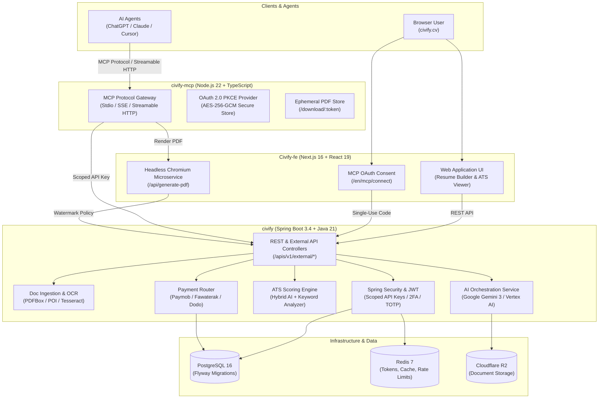

# 🚀 Civify

### The Open-Source AI Career Platform & Resume Intelligence Engine

[](https://civify.cv)
[](https://mcp.civify.cv/mcp)
[](https://www.npmjs.com/package/@civify/mcp-server)
[](https://www.gnu.org/licenses/agpl-3.0.html)

**Civify** is an end-to-end, enterprise-grade career enablement platform and AI agent gateway.  
From structured resume parsing and ATS scoring to job-specific tailoring, PII redaction, high-fidelity PDF rendering, and Model Context Protocol (MCP) agent tools.

[🌐 Live Production](https://civify.cv) • [📖 Documentation](https://civify.cv/apis/civify-docs-ui) • [🤖 MCP Gateway](https://mcp.civify.cv/mcp) • [🚀 Quick Start](#-quick-start) • [📐 Architecture](#-system-architecture)

---

## 🌟 Overview

**Civify** brings together a modern web platform, a robust enterprise microservice backend, and an autonomous AI agent interface to revolutionize how job seekers prepare applications and how AI assistants interact with career documents.

The Civify ecosystem is composed of three core subsystems:

1. **[`Civify-fe`](https://github.com/EngAbdalrhman/Civify-fe)** — Next.js 16 & React 19 Frontend, featuring an interactive resume builder, rich-text editing, multi-language support (English & Arabic with RTL), headless Chromium PDF export microservice, and MCP OAuth consent UI.
2. **[`civify`](https://github.com/EngAbdalrhman/Civify)** — Core Spring Boot 3.4 & Java 21 Backend, delivering multi-format document ingestion (PDF, DOCX, OCR), dual-engine ATS scoring, Gemini 3 / Vertex AI CV tailoring, PII redaction, Flyway database migrations, Redis caching, and global/regional multi-gateway payments.
3. **[`civify-mcp`](https://github.com/TechnoLaps/civify-mcp)** — Model Context Protocol (MCP) Gateway, exposing Civify's intelligence directly to LLM agents (ChatGPT, Claude Desktop, Cursor, OpenCode, Cline) via Stdio, SSE, and Streamable HTTP with OAuth 2.0 PKCE authentication.

---

## 📐 System Architecture

Civify connects end users, browser clients, and external AI agent runtimes through a decoupled, highly resilient architecture:



---

## ⚡ Core Features

### 1. 🎨 Interactive AI Resume Builder (`Civify-fe`)
- **Visual Drag & Drop**: Reorder resume sections, experiences, and education blocks with smooth micro-interactions via `@dnd-kit`.
- **Rich Text Experience**: In-place content styling, bullet point refinement, and formatting powered by Tiptap editor.
- **ATS-Compliant Layouts**: Professionally designed, recruiter-tested templates engineered for machine readability.
- **Full Internationalization (i18n)**: Native English and Arabic localization with automatic Right-to-Left (RTL) typography switching (`next-intl`).
- **Interactive Tour & Onboarding**: Built-in guided walk-throughs using `driver.js`.

### 2. 🧠 Intelligent CV Tailoring & ATS Scoring (`civify`)
- **Job Description Alignment**: Automatically extracts key competencies from job postings and tailors CV bullet points to match the target position without fabricating experience.
- **Hybrid ATS Scoring**: Combines semantic AI analysis (Vertex AI / Gemini 3 Flash) with deterministic keyword matching to provide an accurate percentage score, keyword gap analysis, and section-by-section critique.
- **Job Posting Scraper**: Scrapes and normalizes job descriptions directly from target job URLs (`civify_scrape_job`).
- **Interview & Roadmap Companion**: Generates role-specific interview preparation questions and personalized career progression roadmaps based on the tailored CV.

### 3. 🛡️ PII Masking & Privacy Shield (`civify` & `civify-mcp`)
- **Candidate Anonymization**: Automatically redacts personally identifiable information (PII)—including candidate full names, phone numbers, email addresses, physical locations, and national identification numbers.
- **Fair Hiring Compliance**: Enables blind resume screening and bias-free candidate evaluations for hiring teams.

### 4. 🖨️ High-Fidelity PDF & DOCX Rendering Engine
- **Serverless Chromium Pipeline**: Utilizes headless Chromium (`@sparticuz/chromium` / `puppeteer-core`) to render print-accurate, pixel-perfect PDFs from JSON resume schemas.
- **Dynamic Watermark Control**: Centralized backend watermark policy applying customizable, semi-transparent brand watermarks for free tiers and pristine exports for premium accounts.
- **Multi-Format Export**: Generates both PDF documents and editable Microsoft Word (`.docx`) files.

### 5. 🤖 Autonomous Model Context Protocol Gateway (`civify-mcp`)
- **Direct Agent Connection**: Enables AI assistants (Claude, ChatGPT, Cursor, OpenCode) to perform end-to-end career workflows conversationally.
- **Triple Transport Architecture**:
  - **Stdio**: Local CLI integration for Claude Desktop and Cursor.
  - **Streamable HTTP**: Modern MCP specification (`/mcp`) for hosted connectors.
  - **Remote SSE**: Legacy SSE endpoint (`/sse`) for backwards-compatible tooling.
- **Native Attachment Handling**: Direct support for file uploads via OpenAI's `openai/fileParams`, base64 documents, external HTTPS URLs, or raw text extraction.
- **Hosted ChatGPT OAuth**: Full RFC 7636 PKCE S256 authorization flow allowing ChatGPT users to connect their `civify.cv` accounts securely without exposing passwords or static API keys.
- **Temporary Ephemeral Downloads**: Generated PDFs are securely served via short-lived, signed download URLs (`/download/:token`).

### 6. 💳 Multi-Gateway Billing & Geo-Routing
- **MENA & Global Coverage**:
  - **Paymob**: Credit Cards, Mobile Wallets (Vodafone Cash, Orange, etc.) in EGP.
  - **Fawaterak**: Regional payment options across Egypt and MENA.
  - **Dodo Payments**: International credit and debit processing in USD.
- **Geo-IP Routing**: Automatically routes users to the optimal regional gateway using MaxMind GeoLite2 country detection.
- **Flexible Token & Subscription Packages**: Pay-per-CV passes, credit bundles, and subscription plans with automated usage tracking.

### 7. 🔒 Enterprise Security & Performance
- **Scoped API Key Architecture**: Fine-grained authorization permissions (`cv:parse`, `cv:tailor`, `ats:score`, `pii:mask`, `billing:read`, `apps:write`).
- **Zero-Trust Rate Limiting**: Distributed token-bucket rate limiting via Bucket4j and Redis.
- **Resilient DNS Dispatcher**: Custom in-process DNS caching and fallback resolver (Cloudflare `1.1.1.1` & Google `8.8.8.8`) mitigating transient container network drops.
- **Two-Factor Authentication (2FA)**: Time-based One-Time Password (TOTP) and email OTP verification.

---

## 🗂️ Project Structure

```text
Civify/
├── Civify-fe/               # 🎨 Frontend Web Application & PDF Renderer (Next.js 16)
│   ├── src/app/             # App Router pages (Dashboard, Resume Builder, ATS, MCP Connect)
│   ├── src/components/      # UI component library (Radix UI, Tailwind CSS)
│   ├── src/features/        # Feature modules (resume editor, analytics, payment dialogs)
│   ├── src/lib/             # SSR dispatcher, API clients, authentication utilities
│   └── messages/            # English (en) and Arabic (ar) i18n translation bundles
│
├── civify/                  # ⚙️ Core Backend Service (Spring Boot 3.4 / Java 21)
│   ├── src/main/java/       # Domain entities, REST controllers, service implementations
│   │   ├── controller/      # REST API endpoints (/v1/external, /auth, /payments)
│   │   ├── service/         # AI orchestration, ATS scoring, document parsing, billing
│   │   ├── security/        # JWT filter, API key scope interceptor, OAuth2 handlers
│   │   └── repository/      # Spring Data JPA repositories
│   └── src/main/resources/  # Database migrations (Flyway), application configurations
│
├── civify-mcp/              # 🔌 Model Context Protocol Server (Node.js 22 / TypeScript)
│   ├── src/index.ts         # Main MCP server, transport initialization & tool registry
│   ├── src/oauth.ts         # RFC 7636 OAuth 2.0 PKCE authorization server
│   ├── src/attachments.ts   # Multi-format document decoder (base64, URL, text, attachments)
│   ├── src/downloads.ts     # Ephemeral in-memory PDF download manager
│   ├── src/resume-schema.ts # JSON Resume standard schemas & validation
│   └── test/                # Comprehensive mock-backend integration test suite
│
├── Knowledge/               # 📚 Architectural documentation, runbooks, and API contracts
└── AGENTS.md                # 🤖 Workspace guidelines for AI agents
```

---

## 🛠️ Tech Stack

| Layer | Technologies |
| --- | --- |
| **Frontend** | [Next.js 16](https://nextjs.org), [React 19](https://react.dev), [Tailwind CSS v4](https://tailwindcss.com), [Radix UI](https://www.radix-ui.com), [Tiptap](https://tiptap.dev), [`@dnd-kit`](https://dndkit.com), [Puppeteer](https://pptr.dev), [Biome](https://biomejs.dev) |
| **Backend** | [Java 21](https://www.oracle.com/java/), [Spring Boot 3.4](https://spring.io/projects/spring-boot), [Spring Security](https://spring.io/projects/spring-security), [Spring AI](https://spring.io/projects/spring-ai), [Hibernate / JPA](https://hibernate.org) |
| **AI & LLM** | [Google Gemini 3 Flash](https://deepmind.google/technologies/gemini/), [Google Cloud Vertex AI](https://cloud.google.com/vertex-ai), [Spring AI Gemini Tokenizer](https://spring.io/projects/spring-ai) |
| **Agent Protocol** | [Model Context Protocol (MCP)](https://modelcontextprotocol.io), [`@modelcontextprotocol/sdk`](https://www.npmjs.com/package/@modelcontextprotocol/sdk), Express, TypeScript 5.7 |
| **Database & Cache** | [PostgreSQL 16](https://www.postgresql.org), [Flyway](https://flywaydb.org), [Redis 7](https://redis.io), [Lettuce](https://lettuce.io) |
| **Document Processing** | [Apache PDFBox 3.0](https://pdfbox.apache.org), [Apache POI 5.2](https://poi.apache.org), [Tesseract OCR (Tess4J)](https://tess4j.sourceforge.net), [Apache Tika](https://tika.apache.org) |
| **Object Storage** | [Cloudflare R2](https://www.cloudflare.com/developer-platform/r2/) (S3-compatible via AWS SDK v2) |
| **Payments** | [Paymob](https://paymob.com), [Fawaterak](https://fawaterk.com), [Dodo Payments](https://dodopayments.com), [MaxMind GeoLite2](https://dev.maxmind.com/geoip/geolite2-free-geolocation-data) |
| **DevOps & CI/CD** | [Docker](https://www.docker.com), [GitHub Actions](https://github.com/features/actions), [Dokploy](https://dokploy.com) |

---

## 🚀 Quick Start

### Prerequisites
- **Java 21** (JDK 21 LTS)
- **Node.js 22.x** & **npm 10+**
- **Maven 3.9+**
- **PostgreSQL 16+**
- **Redis 7+**

---

### 1. Backend Setup (`civify`)

```bash
# Navigate to the backend directory
cd civify

# Configure your environment variables (or create an .env / update application-dev.properties)
export DB_URL="jdbc:postgresql://localhost:5432/civify"
export DB_USERNAME="postgres"
export DB_PASSWORD="your_password"
export REDIS_HOST="localhost"
export REDIS_PORT="6379"
export GEMINI_API_KEY="your_google_gemini_api_key"
export JWT_SECRET="your_secure_jwt_secret_minimum_64_characters_long_for_hmac_sha512"

# Run database migrations and start the Spring Boot server
mvn spring-boot:run
```

The backend starts on `http://localhost:8077/apis`.
Swagger UI documentation will be accessible at: `http://localhost:8077/apis/civify-docs-ui`.

---

### 2. Frontend Setup (`Civify-fe`)

```bash
# Navigate to the frontend directory
cd Civify-fe

# Install dependencies
npm install

# Configure environment variables
cp .env.example .env.local
# Set NEXT_PUBLIC_API_URL=http://localhost:8077/apis
# Set NEXT_PUBLIC_BASE_URL=http://localhost:3000

# Start development server
npm run dev
```

The web application opens at `http://localhost:3000`.

---

### 3. MCP Gateway Setup (`civify-mcp`)

#### Option A: Local Stdio Mode (Claude Desktop / Cursor)

Run the local build:
```bash
cd civify-mcp
npm install
npm run build
```

Configure in Claude Desktop (`claude_desktop_config.json`):
```json
{
  "mcpServers": {
    "civify": {
      "command": "node",
      "args": ["c:/Projects/Civify/civify-mcp/dist/index.js"],
      "env": {
        "CIVIFY_API_URL": "http://localhost:8077/apis",
        "CIVIFY_FRONTEND_URL": "http://localhost:3000",
        "CIVIFY_API_KEY": "your_civify_api_key"
      }
    }
  }
}
```

Or run directly via npm:
```json
{
  "mcpServers": {
    "civify": {
      "command": "npx",
      "args": ["-y", "@civify/mcp-server"],
      "env": {
        "CIVIFY_API_KEY": "your_civify_api_key"
      }
    }
  }
}
```

#### Option B: Remote Streamable HTTP / OAuth Mode (ChatGPT)

```bash
cd civify-mcp
export PORT=8080
export TRANSPORT="sse"
export CIVIFY_API_URL="https://civify.cv/apis"
export CIVIFY_FRONTEND_URL="https://civify.cv"
export CIVIFY_MCP_PUBLIC_URL="https://mcp.civify.cv"
export CIVIFY_OAUTH_STORE_KEY="base64_encoded_32_byte_secret_key"
export CIVIFY_OAUTH_STORE_PATH="./data/oauth.enc"

node dist/index.js
```

---

## 🤖 MCP Agent Tools Reference

`civify-mcp` exposes 13 tools in hosted OAuth mode and 18 tools in local stdio mode:

| Tool | Access | Description |
| --- | --- | --- |
| `civify_get_started` | Public | Returns onboarding guide, tool workflows, and JSON resume schemas. |
| `civify_scrape_job` | Public | Extracts and structures job title, company, requirements, and responsibilities from a job URL. |
| `civify_get_pay_per_cv_pricing` | Public | Retrieves current pricing for pay-per-CV passes and token packages. |
| `civify_generate_pdf` | Public | Renders a styled, print-ready PDF from structured resume data using Civify's Chromium engine. |
| `civify_get_account` | `account:read` | Returns the authenticated user profile, tier, and remaining AI credit balance. |
| `civify_parse_cv` | `cv:parse` | Parses an uploaded PDF/DOCX resume file or text into structured JSON. |
| `civify_score_ats` | `ats:score` | Evaluates a resume against ATS requirements or a job description with comprehensive scoring. |
| `civify_tailor_cv` | `cv:tailor` | Tailors CV achievements and keywords to match a job description, returning tailored data & PDF. |
| `civify_mask_pii` | `pii:mask` | Redacts personally identifiable information (contact info, address, IDs) for bias-free evaluation. |
| `civify_track_application` | `apps:write` | Creates or updates a job application entry in the candidate's tracking board. |
| `civify_list_applications` | `apps:read` | Lists tracked job applications and statuses. |
| `civify_check_cv_entitlement` | `billing:read` | Checks whether the account holds an active export entitlement or pass for a specific CV. |
| `civify_purchase_cv_pass` | `billing:purchase` | Initiates purchase for a single or pack-of-3 CV export passes. |

---

## ⚙️ Key Environment Variables

### Backend (`civify`)
| Variable | Default | Purpose |
| --- | --- | --- |
| `DB_URL` | `jdbc:postgresql://localhost:5432/civify` | PostgreSQL connection JDBC URL |
| `DB_USERNAME` | `postgres` | Database username |
| `DB_PASSWORD` | - | Database password |
| `REDIS_HOST` / `REDIS_PORT` | `localhost` / `6379` | Redis cache and token bucket host/port |
| `JWT_SECRET` | - | 512-bit secret for HMAC-SHA512 token signing |
| `PERMISSIONS_KEY` | - | 32-byte key for AES-256 user permission encryption |
| `GEMINI_API_KEY` | - | Google Gemini AI API key |
| `VERTEX_API_KEY` | - | Google Vertex AI API key |
| `R2_ACCESS_KEY` / `R2_SECRET_KEY` | - | Cloudflare R2 object storage access credentials |
| `R2_ENDPOINT` | - | Cloudflare R2 S3 API endpoint URL |
| `PAYMOB_SECRET_KEY` | - | Paymob V2 payment processing secret |
| `DODO_PAYMENTS_API_KEY` | - | Dodo Payments API key for international card processing |
| `CIVIFY_MCP_ORIGIN` | `https://mcp.civify.cv` | Trusted origin allowed to exchange MCP OAuth codes |

### MCP Gateway (`civify-mcp`)
| Variable | Default | Purpose |
| --- | --- | --- |
| `PORT` | `8080` (Docker) | Port for HTTP/SSE server |
| `CIVIFY_API_URL` | `https://civify.cv/apis` | Civify backend API endpoint |
| `CIVIFY_FRONTEND_URL` | `https://civify.cv` | Civify frontend service for PDF rendering |
| `CIVIFY_MCP_PUBLIC_URL` | - | Canonical public HTTPS URL of the MCP server (enables OAuth) |
| `CIVIFY_OAUTH_STORE_KEY` | - | 32-byte base64 key for encrypting local OAuth token database |
| `CIVIFY_OAUTH_STORE_PATH` | `./data/oauth.enc` | Local file path for encrypted OAuth database |
| `CIVIFY_API_KEY` | - | Static API key for local stdio usage |

### Frontend (`Civify-fe`)
| Variable | Default | Purpose |
| --- | --- | --- |
| `NEXT_PUBLIC_API_URL` | `http://localhost:8077/apis` | Backend API base URL accessible from browser |
| `NEXT_PUBLIC_BASE_URL` | `http://localhost:3000` | Web application public base URL |
| `PDF_INTERNAL_SECRET` | - | Shared secret authenticating internal PDF generation requests |

---

## 🧪 Testing & Validation

### MCP Gateway Tests
The MCP gateway includes a robust integration suite running against a mock backend covering triple transports, OAuth PKCE, error handling, and payload isolation:

```bash
cd civify-mcp
npm test
```

### Backend Unit & Integration Tests
```bash
cd civify
mvn clean test
```

---

## 🤝 Contributing

We welcome contributions from the community! To contribute:

1. **Fork** the repository.
2. **Create a Feature Branch**: `git checkout -b feature/amazing-feature`.
3. **Commit your Changes**: `git commit -m 'feat: add amazing feature'`.
4. **Push to the Branch**: `git push origin feature/amazing-feature`.
5. **Open a Pull Request**.

Please ensure that tests pass before opening a pull request. Never commit credentials, secrets, or `.env` files.

---

## 📄 License

The Civify frontend, backend, and MCP gateway are licensed under the **GNU Affero
General Public License v3.0 or later** (`AGPL-3.0-or-later`). See the canonical
license text in each repository: [frontend](Civify-fe/LICENSE),
[backend](civify/LICENSE), and [MCP gateway](civify-mcp/LICENSE).

### What AGPLv3 means

- You may use, study, modify, and distribute Civify, including for commercial work,
  provided you meet the license terms.
- If you modify Civify and provide it to users over a network, such as by operating
  a hosted web app, API, or MCP service, you must offer those users the corresponding
  source code for your modified version under AGPLv3.
- You must preserve copyright and license notices, and provide the AGPLv3 license
  with copies you distribute.
- AGPLv3 does not grant permission to use the Civify name, logo, or other brand
  assets. Do not imply that an independent deployment is the official Civify service.

Commercial use is permitted under AGPLv3; it does not require automatic approval
from Civify when the AGPLv3 obligations are met. Organisations that need rights
outside AGPLv3, such as keeping modifications private, should contact
[Civify](https://civify.cv) to discuss a separate commercial license. A commercial
license is not granted by this repository.

### Contributions and releases

By submitting a contribution, you agree that it may be distributed under AGPLv3.
Do not submit code, documents, data, or assets that you do not have permission to
contribute. Maintainers must obtain appropriate contributor permission before
relicensing community contributions under different terms.

---

**Civify** — Built with passion for career advancement and AI innovation.  
Visit the live platform at **[civify.cv](https://civify.cv)**

